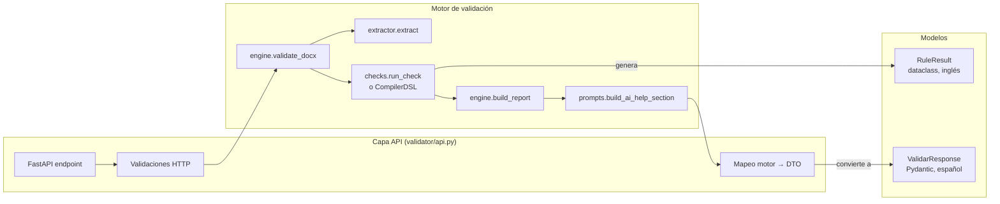

# Flujo del endpoint POST /validar

**Versión del contrato**: 1.14.0<br>
**Fecha**: 2026-11-16

> Este documento describe el flujo de `POST /validar` y el buzón de la ficha.
> El contrato completo, incluidos constancia y registro, está en
> `docs/CONTRATO_API.md` (v1.14.0).

---

## Diagrama de flujo completo

```mermaid
flowchart TD
    A[Frontend<br/>POST /validar<br/>multipart/form-data] --> B{¿Hay campo archivo?}
    B -->|No| C[422<br/>FastAPI: campo requerido]
    B -->|Sí| B2{¿Nombre vacío?}
    B2 -->|Sí| C2[400<br/>Campo archivo sin nombre]
    B2 -->|No| D{¿Extensión .docx?}
    D -->|No| E[415<br/>Tipo no soportado]
    D -->|Sí| F{Content-Type<br/>advisory check}
    F -->|No soportado| E
    F -->|OK / vacío| F2{¿correo presente<br/>y válido?}
    F2 -->|Inválido| F3[422<br/>Correo electrónico inválido]
    F2 -->|Válido / ausente / vacío| G[Leer contenido]
    G --> H{¿Tamaño > 10 MB?}
    H -->|Sí| I[413<br/>Archivo excede tamaño máximo]
    H -->|No| J{¿Archivo vacío?}
    J -->|Sí| K[422<br/>Archivo vacío]
    J -->|No| J2{¿Cabecera PK\x03\x04?}
    J2 -->|No| J3[422<br/>Cabecera ZIP inválida]
    J2 -->|Sí| L[Guardar en temp file]
    L --> M[engine.validate_docx<br/>+ build_report]
    M --> N{¿éxito?}
    N -->|ZIP corrupto / XML inválido| O[422<br/>DOCX inválido]
    N -->|Error inesperado| P[500<br/>Error interno]
    N -->|Éxito| Q{¿incluir_prompts_ia?}
    Q -->|true| R[build_ai_help_section]
    Q -->|false| S[prompts = []]
    R --> T[Construir ValidarResponse<br/>mapear RuleResult → DTO]
    S --> T
    T --> N2{Notificación:<br/>¿notificar + correo<br/>+ semáforo rojo?}
    N2 -->|No aplica| N3[estado: sin_correo /<br/>no_solicitado / sin_observaciones]
    N2 -->|Sí, pero SMTP deshabilitado| N4[estado: deshabilitado<br/>detalle: nota de configuración]
    N2 -->|Sí y habilitado| N5[enviar_notificacion<br/>best-effort]
    N5 -->|Aceptado| N6[estado: enviado]
    N5 -->|Fallo SMTP| N7[estado: fallo<br/>detalle: motivo técnico]
    T --> D2{Depósito:<br/>¿depositar?}
    D2 -->|No| D3[estado: sin_solicitud]
    D2 -->|Sí| D4[estado: deshabilitado<br/>nota: flujo oficial<br/>formulario + userscript]
    N3 --> U[200 OK<br/>ValidarResponse JSON]
    N4 --> U
    N6 --> U
    N7 --> U
    D3 --> U
    D4 --> U
    L --> V[finally: unlink temp file]
    O --> V
    P --> V
    U --> V
```

> **Nota**: la notificación nunca cambia el código HTTP — todos los estados
> de envío (incluido `fallo`) responden `200 OK`. Ver
> `docs/CONTRATO_API.md` § "Notificación de observaciones por correo".
>
> **Depósito deprecado (2026-10-28)**: `depositar=true` ya no llama a la API
> de DSpace. Responde `deshabilitado` con una nota: el flujo oficial es la
> ficha → buzón → userscript, y el archivo lo adjunta el encargado en el
> formulario oficial. Los estados `enviado` y `fallo` del DTO se conservan
> solo por compatibilidad del contrato.

---

## Capas de abstracción



---

## Detalle de validaciones HTTP

| Paso | Código | Condición |
|------|--------|-----------|
| Campo requerido | 422 | `archivo` no está en el request |
| Nombre de archivo | 400 | Campo presente pero `filename` vacío |
| Extensión | 415 | Nombre no termina en `.docx` |
| Content-Type | 415 | MIME type no es `.docx` ni `application/octet-stream` |
| Correo (opcional) | 422 | Campo `correo` presente pero formato inválido |
| Tamaño | 413 | Contenido > 10 MB |
| Vacío | 422 | 0 bytes |
| Magic bytes | 422 | Cabecera no es `PK\x03\x04` (no es ZIP) |
| DOCX corrupto | 422 | BadZipFile, KeyError (sin document.xml), ValueError, XML inválido |
| Error interno | 500 | Cualquier otra excepción |

> La notificación (`notificar`/`correo`) **no** genera códigos de error: es
> best-effort y todos sus desenlaces (incluido `fallo`) responden `200`.

---

## Mapeo motor → API (fieldName)

| Motor (`RuleResult`) | API (`ResultadoReglaAPI`) | Nota |
|----------------------|---------------------------|------|
| `rule_id` | `rule_id` | Sin cambio |
| `passed` | `paso` | Renombrado |
| `severity` | `severidad` | `"error"` o `"warning"` |
| `message` | `mensaje` | Renombrado |
| `expected` | `esperado` | Renombrado |
| `found` | `encontrado` | Renombrado |
| `location` | `ubicacion` | Renombrado |
| `fuente` | `fuente` | Sin cambio |
| `cita` | `cita` | Sin cambio |
| `aplicable` | `aplicable` | `false` = regla omitida por tipo de documento (Semana 7, paso 7) |
| — | `metadatos` | Solo en API (nombre, tamaño, reglas evaluadas/totales, tipo de documento, versión) |

---

## Semáforo (regla de negocio)

El semáforo **siempre** se calcula sobre **TODOS** los resultados, sin importar el filtro de severidad:

- `"rojo"` si **al menos una regla** `severity=error` falla (`passed=false`)
- `"verde"` si **todas** las reglas `severity=error` pasan
- Las `warning` no afectan el semáforo (pero sí aparecen en el reporte)

```python
# validator/engine.py:105-107
hay_error_bloqueante = any(
    (not r.passed) and r.severity == Severity.ERROR for r in results
)
semaforo = "rojo" if hay_error_bloqueante else "verde"
```

---

## Formatos de reglas soportados

El engine acepta dos formatos YAML, ambos producen `List[RuleResult]`:

| Formato | Key raíz | Evaluador | Estado |
|---------|----------|-----------|--------|
| Legacy | `rules` | `checks.run_check()` | Activo, estable (no es el que carga la API desde la F5) |
| DSL | `reglas` | `CompilerDSL` | Activo (Semana 3); **carga la API desde la F5 (Semana 4)** |

Detección automática en `engine.validate_docx()`:

```python
if "reglas" in rules_data:
    return CompilerDSL().ejecutar(rules_data, extracted)
return _validate_legacy(rules_data, extracted)
```

---

## Buzón del trámite de depósito (ficha de depósito, desde v1.7.0, v1.14.0)

Comunicación entre la SPA y el userscript que corre sobre las páginas de
DSpace en el navegador del operador. Sin archivos, sin pegar, sin
sesiones: una ranura en memoria del proceso, "última gana". La app nunca
escribe a la API de DSpace; el formulario oficial construye todas las
peticiones.

```
SPA                        buzón (api.py)              userscript (DSpace)
────                       ───────────────            ────────────────────
[Preparar depósito] ──► POST /ficha-pendiente ──►
                                                       GET /ficha-pendiente
                                                         → rellena el formulario
[Operador adjunta el .docx y pulsa Depositar]
                                                       POST /deposito no: aún no
(panel en espera) ◄──── GET /tramite ◄──────────── GET /tramite (revisión)
                                                        → panel de confirmación
[Operador confirma]  ──────────────────────────► POST /deposito
                                                        (atestación del operador)
(panel en espera) ◄──── GET /deposito ◄──────────── (estado confirmado)
```

- La ficha solo existe con semáforo verde (invariante con test).
- `POST /ficha-pendiente` responde **201** con `{tramite_id, revision,
  autofill_hasta, retenido_hasta, vence_en}`. Cada publicación crea un
  trámite nuevo y descarta el depósito anterior, aunque el título sea el
  mismo.
- `GET /ficha-pendiente` devuelve la ficha y su identidad; `404` cuando
  la ventana de autorrelleno (1 h) venció. El trámite completo sigue en
  `GET /tramite` (retención de 24 h).
- El clic en "Depositar" solo aporta la `timestamp` (hora del papeleo).
- `POST /deposito` es un contrato incompatible con v1.13.0: exige
  `atestacion: "operador"` y `revision_esperada`. El payload automático
  anterior recibe **422** y no habilita papeleo.
- `GET /deposito` devuelve la confirmación con `revision_confirmada`,
  `confirmado_en`, `confirmacion_vigente`, `titulo_verificado` y
  `autores_verificados`.
- `POST /ficha-pendiente/reconciliar` reemplaza la ficha canónica e
  invalida la confirmación; `POST /ficha-pendiente/inconsistencia` marca
  una divergencia y bloquea el papeleo.
- El buzón no emite CORS: una página web cualquiera del navegador no
  puede leer la ficha (datos personales del estudiante).