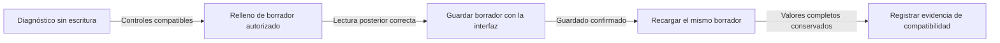

# Handover Integrante 1 — retblast: API y userscript — 2026-11-12

**Estado:** tareas pendientes. Implementar solo los archivos asignados a este integrante.
Ver [índice y estado común](HANDOVER_CORRECTITUD_2026-11-12.md).
Las dependencias de [Int1](HANDOVER_CORRECTITUD_INT1_2026-11-12.md),
[Int2](HANDOVER_CORRECTITUD_INT2_2026-11-12.md) e
[Int3](HANDOVER_CORRECTITUD_INT3_2026-11-12.md) no autorizan a editar sus archivos.

**Lista de retblast:** B1–B8. B5 espera M1a de Int3; B6 espera M11 de Int3.
No implementar tareas F ni M.

## 1. Tareas propias

### B1. Calibrar el límite con documentos reales — VA-19

**Archivos:** `validator/api.py` (`LimitadorCPU`, `limitar_validaciones`),
`tests/test_api_concurrencia.py`, `README.md`, `docs/INSTALACION.md`.

- Evidencia: tesis aprobada → 200 en 17,99 s; petición inmediata siguiente →
  429 con `Retry-After: 223`. Configuración por defecto, peticiones secuenciales.
- Medir CPU y latencia en la máquina del operador. Ajustar presupuesto y
  ventana para el ritmo acordado. Mantener una prueba de rechazo por abuso.
- **Aceptación:** dos validaciones legítimas consecutivas y una corrección
  inmediata funcionan con la configuración documentada. Probar ambas llamadas
  dentro del mismo test, sin limpiar el limitador entre ellas. El factory
  pequeño no sustituye la medición real. No desactivar el límite como arreglo.

### B2. Identificar el trámite de depósito — VA-09

**Archivos:** `validator/buzon.py`, `api.py`, `api_models.py`,
`tools/dspace-fill/src/{wrapper,compuertas}.js`, tests de API/buzón/userscript.
**Dependencia compartida:** F2. Int1 fija el contrato antes de que Int2 implemente.

Contrato objetivo propuesto; todavía no es el contrato vigente:

| Operación | Cambio que debe documentar Int1 |
|---|---|
| `POST /ficha-pendiente` | Recibe ficha; devuelve un `tramite_id` nuevo y su vencimiento |
| `GET /ficha-pendiente` | Devuelve ficha, `tramite_id` y vencimiento |
| `POST /deposito` | Exige `tramite_id`, título observado, handle y timestamp |
| `GET /deposito` | Devuelve el mismo `tramite_id` con el resultado |
| `/constancia` y `/fila-registro` | Vinculan la solicitud con el depósito del trámite vigente |

- Fijar campos, códigos HTTP y versión en `docs/CONTRATO_API.md` antes de
  cambiar código. Int1 actualiza API, OpenAPI, ejemplos, userscript, mock y
  driver. Int2 actualiza la SPA en F2. Int1 no modifica `frontend/`.
- Generar identidad nueva incluso si se repite el título. Publicar una ficha
  nueva invalida el depósito anterior. Conservar la ranura única y el TTL.
- Rechazar ID desconocido, vencido o de otro trámite. Nunca aceptar solo porque
  el título coincide. Falta de ID no puede activar una ruta insegura de compatibilidad.
- Reiniciar timestamp si cambia el trámite. Conservarlo solo en reintentos del
  mismo trámite. No inventar la hora al abrir una página de ítem sin clic previo.
- Reportar el título observado del ítem. El actual `envio.titulo` es el título
  esperado y no sirve como confirmación independiente. Evitar coincidencia por
  inclusión: «Educación» no identifica «Educación y cultura en otra institución».
- Marcar un handle como reportado solo tras respuesta exitosa. Permitir reintento
  acotado si la API falla. Un fallo no puede bloquear el handle para siempre.
- **Aceptación:** dos tesis sucesivas; mismo título con distinto trámite; otra
  pestaña; depósito viejo; TTL vencido; API temporalmente caída; reintento del
  mismo trámite. Solo el depósito vigente habilita el papeleo en F2.

### B3. Diagnóstico previo y verificación de Angular — VA-20

**Archivos:** nuevo `tools/dspace-fill/src/preflight.js`, `ejecutor.js`,
`wrapper.js`, `dev/build.js`, pruebas en `tools/dspace-fill/test/`,
`docs/PILOTO_OPERADOR.md`. Agregar el módulo al build y regenerar `dist/`.

**Comprobado localmente:** el HTML guardado declara Angular 17.3.12 y contiene
los 14 selectores actuales. El ejecutor usa setter nativo y eventos
`input`/`change`; no comprueba `disabled`, `readOnly` ni relee el resultado.
Informa éxito incluso si un listener restaura el valor original. Los tests
jsdom y el mock no ejecutan los formularios reactivos reales de Angular.

Construir tres comprobaciones separadas:

1. **Diagnóstico sin escritura.** Botón «Comprobar formulario», disponible antes
   del relleno. No escribe campos, pulsa botones, crea filas ni guarda en DSpace.
   Comprueba la ruta, contenedor activo, ficha vigente, controles visibles,
   conectados y editables, selectores únicos para campos simples, estructura de
   repetibles, pares tipo/DNI por fila y opciones QUALDROP. Detecta un render
   incompleto y espera con plazo explícito. No afirmar que un listbox vacío
   antes de buscar una opción demuestra incompatibilidad.
2. **Lectura posterior al relleno.** Reconsultar los controles después del render.
   Comparar valores completos, orden y número de filas. Verificar validación
   del campo y selección de vocabulario. Un input con «Acceso abierto» escrito
   no demuestra que Angular seleccionó su URI. Considerar blur solo cuando el
   control lo requiera; no simular Enter ni submit. No depender de `window.ng`:
   los métodos de depuración pueden no existir en producción.
3. **Persistencia en borrador autorizado.** Seguir §2 de este documento. Solo esta prueba demuestra
   que el servidor conservó los metadatos de esta versión del formulario.

El resultado debe nombrar el campo, la fase y el motivo. Estados mínimos:
`compatible`, `pendiente`, `incompatible`, `verificado_en_dom`.
«Compatible» no significa «guardado». No registrar valores personales ni usar
una lista de éxitos que solo diga `texto`, `filas` o `qualdrop`.

**Aceptación automatizada:** control ausente, duplicado, oculto, deshabilitado,
readonly, reemplazado tras render, valor revertido, render lento, filas
sobrantes y vocabulario no seleccionado no se reportan como éxito. El modo de
diagnóstico deja iguales valores, filas y llamadas de red de escritura.
Usar el lockfile propio del userscript al ejecutar sus pruebas.

### B4. Reconciliar filas — VA-08

**Archivos:** `tools/dspace-fill/src/ejecutor.js`, tests del ejecutor y mock.

- Evidencia: dos inputs de autor + plan con uno → conserva el segundo antiguo
  y declara éxito. También revisar palabras clave y QUALDROP de DNI.
- Eliminar filas sobrantes con los controles del propio campo y esperar el
  render. No borrar nodos manualmente: Angular puede conservarlos en su modelo.
- Si no se puede reconciliar, detener el relleno y nombrar el campo pendiente.
  No sobrescribir formularios ajenos sin advertirlo.
- **Aceptación:** 1→2 y 2→1 autores, DNI y palabras clave; botón ausente;
  render superior a los 960 ms actuales; pares autor/DNI sin desplazamientos.

### B5. Traducir entradas inválidas a 422 — VA-11

**Archivos:** `validator/api.py`, `tests/test_api_contract.py`.
**Dependencia:** M1a, que implementa Int3. Int1 no modifica el extractor.

- Capturar la excepción de documento inválido definida por M1a. No traducir
  fallos de reglas/configuración a errores del estudiante. No devolver trazas.
- **Aceptación:** ZIP con XML `<broken`, raíz ajena y ausencia de cuerpo → 422;
  configuración de reglas inválida → 500; DOCX admitido → respuesta normal.

### B6. Reparar ejemplos y guardias — VA-17

**Archivos de Int1:** `docs/ejemplos/`, `tests/test_ejemplos_versionados.py`,
`scripts/ejemplo_bueno_malo.py`. **Dependencia:** M11 de Int3.
Int1 no modifica `tests/_xml_constants.py` ni el builder del motor.

- Ambos DOCX versionados referencian `media/logo.png`, que falta. Int3 repara
  el factory en M11; después Int1 regenera los ejemplos y verifica el paquete.
- Enviar a la API los bytes de los archivos versionados. Hoy la guardia
  regenera otros documentos y no detecta el daño del archivo entregado.
- Comparar también `ficha_deposito`, listas completas de reglas y prompts.
- **Aceptación:** ambos archivos abren con `python-docx`; destinos de relaciones
  internas existen; respuestas coinciden con los JSON actualizados. Un archivo
  dañado o una ficha desactualizada hace fallar la guardia.

### B7. Contar reglas evaluadas en el correo — VA-18

**Archivos:** `validator/notificacion.py`, `tests/test_notificacion.py`.
Usar `total_evaluadas`, no `total`, bajo la etiqueta «evaluadas».
**Aceptación:** reporte con 49 totales y 41 evaluadas muestra 41 en HTML y texto.
Coordinar la misma corrección de CLI/exportador con M10.

### B8. Detectar autofill y formularios restaurados — VA-21

**Archivos:** `tools/dspace-fill/src/{preflight,wrapper,ejecutor}.js`, pruebas,
mock y checklist de §2. **Coordinar:** F5. No confundir este riesgo con VA-10.

- El usuario informa que reaparecen datos guardados por el navegador. Verificar
  en el navegador real cuál es la fuente: autofill/historial de formularios,
  restauración de pestaña o navegación Atrás/Adelante, borrador de DSpace,
  estado de Angular o almacenamiento de VistoBueno (`vb-ficha-deposito` en
  localStorage y `vb_envio` en GM storage). No afirmar una causa sin prueba.
- Antes de rellenar, leer **todos** los valores y filas del formulario activo.
  Clasificar cada campo: vacío, igual al esperado, diferente o fuera del plan.
  Si aparecen autores, DNI, título, resumen o palabras clave ajenos, detener
  el auto-relleno y pedir revisión explícita. No usar esos datos como fuente
  de la nueva ficha. Un título coincidente no confirma el resto del formulario.
- Repetir la comprobación al restaurar página/pestaña y después del render o
  autofill tardío. Escuchar `pageshow` cuando corresponda; reconsultar valores
  antes de actuar. No confiar solo en `input`, `change` o MutationObserver:
  restaurar una propiedad `value` puede no generar esos eventos.
- Detectar cambios posteriores al relleno. Si el navegador o Angular reemplaza
  valores ya comprobados, invalidar la confirmación y nombrar el campo.
- Conservar ediciones manuales del trámite vigente. No borrar campos ni filas
  de un borrador ajeno automáticamente. Aplicar B4 solo después de confirmar
  que ese formulario corresponde al trámite que se está preparando.
- `autocomplete="off"` es una ayuda, no una prueba ni una garantía. No borrar
  el perfil, las contraseñas ni todo el localStorage del navegador.
- **Aceptación:** tesis A de dos autores → cerrar/restaurar o Atrás/Adelante →
  tesis B de un autor; autofill tardío; mismo título con distinto trámite;
  borrador anterior; campo fuera del plan con dato antiguo; edición manual
  vigente. Ningún dato de A se conserva ni se reporta como verificado para B.

La prueba local puede simular restauración cambiando `value` sin evento.
La prueba real debe hacerse con un perfil de prueba con datos ficticios;
un perfil vacío o una ventana privada no demuestran que el caso esté resuelto.

## 2. Puerta de Angular antes del piloto

El diagnóstico de B3 se implementa primero. La compatibilidad completa queda
pendiente hasta ejecutar el siguiente ensayo **antes del piloto con estudiantes**.

El diagrama ordena las pruebas; cada flecha exige la evidencia indicada.

**Responsable:** Int1. **Apoyo:** Int2 comprueba ficha y recuperación; Int3
comprueba que los valores de origen son los esperados. No usar una tesis real
de estudiante para el primer ensayo. Acordar borrador y colección de prueba
con el encargado. No pulsar Depositar. La instancia puede guardar mientras se
escribe; rellenar también puede escribir en el servidor.

1. Usar la versión exacta de `dist/` del PR y Tampermonkey en el navegador del
   operador. Ejecutar el diagnóstico con la página aún sin rellenar.
2. En un borrador autorizado, probar título, dos autores, sus dos DNI en orden,
   asesor/DNI/ORCID, resumen, palabras clave, año y derechos.
3. Confirmar que no hay errores de esos campos. Completar a mano los campos
   fuera del userscript, como OCDE. No confundirlos con fallos del rellenador.
4. Guardar mediante la interfaz, según el flujo real. Esperar confirmación de
   DSpace. Recargar o reabrir el mismo borrador y comparar **todos** los valores,
   orden y número de filas. Para derechos, comprobar el valor canónico, no solo
   la etiqueta. No copiar tokens ni cuerpos de login a la evidencia.
5. Repetir con una autora y un DNI. Ninguna fila antigua puede sobrevivir.
   Repetir tras navegación interna, carga lenta y edición manual del operador.
   Usar también un perfil de prueba con autofill/historial, restaurar una
   pestaña y navegar Atrás/Adelante. Ejecutar B8/F5 con datos ficticios. El
   diagnóstico debe detectar datos previos y cambios tardíos antes de continuar.
6. Registrar fecha, versión del userscript, navegador, versión de DSpace,
   colección y resultado por campo sin PII. Si cambia el formulario, repetir.
7. Cualquier valor perdido, cambiado, duplicado o no persistido bloquea el
   inicio del piloto. Eliminar el borrador solo mediante el procedimiento
   autorizado del encargado; no automatizar la eliminación.

**Qué prueba cada nivel:** HTML guardado = selectores históricos; jsdom =
lógica DOM; lectura posterior = valores visibles; guardar y recargar =
persistencia en esa instancia. Ningún nivel anterior sustituye al último.
