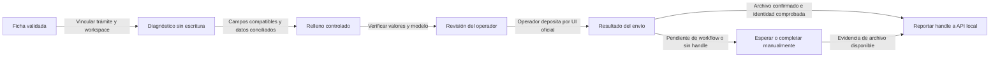

# Handover: auditoría completa del userscript y formulario observado

Fecha: 2026-11-16. Base revisada: `c9e5499`. **Implementa solo Int1 / retblast.**
Estado: inspección y reproducciones; ningún arreglo funcional aplicado.
Este documento amplía B3/B4/B8 y precisa los límites que quedan después de B2.
B2 y B7 entregados no se vuelven a implementar desde el handover antiguo.

## 1. Qué significa «completa» en esta entrega

Se leyeron los seis módulos del userscript (845 líneas), sus seis archivos de
pruebas, fixtures, build, shim, mock y driver e2e. Se trazaron las rutas de ficha,
buzón y depósito de la API, sus DTO y su uso canónico para papeleo. Se contrastaron
con 38 filas del formulario, 14 selectores y el código capturado de los widgets,
filas, guardado, navegación y metadatos. Se extrajeron 37 bundles institucionales;
la lectura de comportamiento se centró en main y el chunk de envío. Esto no es
una auditoría de todo Angular, DSpace o dependencias ni certificación sin defectos.

**No hubo llamadas a UNT, login, guardado ni replay de HAR.** Los contraejemplos
usan DOM/GM simulados o TestClient en memoria. No se ejecutó la app Angular
completa ni se instaló el laboratorio. Los scripts de análisis no corrigen código.
Distinguir fuente capturada, simulación y prueba integrada real. No presentar las
simulaciones como funcionamiento demostrado del servidor de UNT.

La suite actual pasa **46/46**. La auditoría añade **21 contraejemplos Node**,
una prueba de contrato del dropdown y **6 comprobaciones de API y flujo canónico**.
Junto con dos casos de inyección en el mock, son 30 comprobaciones focalizadas,
no 30 defectos independientes. Se agrupan en 17 hallazgos.
Los asserts de los scripts describen el comportamiento observado de esta base;
al corregirlo, invertir la expectativa en una regresión del área. No convertir
el comportamiento incorrecto en una especificación dorada.

## 2. Reglas de dominio y de responsabilidad

- Autores en mayúsculas y minúsculas, como la tesis aprobada por el jefe.
- Emular siempre **Acceso abierto**. La política fija no es un defecto.
- El operador adjunta el archivo y realiza el depósito por la interfaz oficial.
  VistoBueno no escribe directamente en la API de DSpace.
- No hacer guardados experimentales en UNT. Probar escritura solo en laboratorio
  local. El [plan de captura y lab](PLAN_LAB_DSPACE_LOCAL_2026-11-12.md) sigue vigente.
- Int1: userscript, buzón, API, DTO, pruebas de sus áreas y documentación.
  **No tocar frontend, motor, extractor ni YAML de reglas.** Si cambia un contrato,
  Int1 lo publica; Int2 adapta sus propios archivos en una entrega separada.
- No copiar HAR, DOM completo, tokens, personas ni bundles completos a git.
  Esta entrega incluye solo casos ficticios y tres funciones de widget sin datos
  de sesión. `recursos/` conserva las fuentes privadas para la inspección local.
- No debilitar CI. No editar `AGENTS.md` sin aprobación. No reemplazar controles
  de dominio por un click genérico, una pausa arbitraria o una excepción ocultada.

## 3. Estado y orden de trabajo

| ID | Prioridad | Hallazgo | Referencia |
|---|---|---|---|
| US-01 | P1 | Selección de derechos usa un evento incorrecto | B3; pendiente |
| US-02 | P1 | Éxito sin comprobar estado ni valor efectivo del control | B3; pendiente |
| US-03 | P1 | Filas sobrantes y cambios parciales quedan en el formulario | B4; pendiente |
| US-04 | P1 | Filtrar listas por separado desplaza autor y DNI | B4 / validación de ficha; pendiente |
| US-05 | P1 | Relleno parcial se registra como completo y no admite reparación | B3; pendiente |
| US-06 | P1 | Rellenos concurrentes y callbacks atrasados reemplazan estado nuevo | B3; pendiente |
| US-07 | P1 | Sin vínculo entre trámite y workspace/pestaña activa | B3/B8; pendiente |
| US-08 | P1 | La finalización supuesta no corresponde a la navegación real | continuación B2; decisión de flujo; pendiente |
| US-09 | P1 | Se toma el primer enlace hdl de toda la página | continuación B2; pendiente |
| US-10 | P1 | Handle marcado visto antes de poder validarlo | continuación B2; pendiente |
| US-11 | P2 | Fallo inicial de conexión deja sin rescate; no hay plazo explícito | B3; pendiente |
| US-12 | P1 | La API acepta ficha y reporte sin invariantes de dominio | API de ficha / depósito; pendiente |
| US-13 | P1 | Mock y suite dan verde con un contrato distinto al capturado | tests de B3/B4/B8; pendiente |
| US-14 | P2 | Versión de instalación no distingue el cambio de protocolo | entrega del userscript; pendiente |
| US-15 | P2 | Resultado no identifica el campo que falla | B3; pendiente |
| US-16 | P2 | Mock ejecuta HTML de valores de ficha/reporte | pruebas y mock de Int1; pendiente |
| US-17 | P1 | Correcciones en DSpace no se concilian con el papeleo canónico | flujo de Int1; pendiente de política de correcciones |

La [tabla legible por herramientas](auditoria_userscript_2026-11-16/estado.csv)
asigna todos los hallazgos a Int1. No delega trabajo de Int2 o Int3.

| Lote | Trabajo concreto | Puerta de salida |
|---|---|---|
| 0 | Leer reproducciones, preparar regresiones de US-13 y corregir US-16 antes de usar el mock con datos | Las regresiones con expectativa correcta fallan en la base; los scripts de auditoría afirman el comportamiento observado |
| 1 | US-01 a US-04; validación de publicación de US-12 | Cada widget recibe su valor correcto; no hay éxito falso ni desplazamiento de DNI |
| 2 | US-05 a US-07, US-10, US-11 y US-15 | Operación única, cancelable y ligada a workspace; recuperación por campo y errores claros |
| 3 | Resolver US-08/US-09/US-17 y reporte de US-12 | Definición explícita de depósito/archivo/handle; contrato y pruebas de integración local coherentes |
| 4 | US-14, artefacto instalable y ensayo local | Versión nueva, dist sincronizado, instalación Tampermonkey verificada y evidencia de límites |

La siguiente máquina de estados es un objetivo de diseño, no código existente:



El diagrama distingue rellenar, enviar y archivar; cada flecha exige la condición indicada.

## 4. Hallazgos y criterios de aceptación

### US-01 — P1: el dropdown no selecciona con el evento usado

**Archivo:** `tools/dspace-fill/src/ejecutor.js`, `_aplicarCombobox`.
La opción normal de `ds-dynamic-scrollable-dropdown` enlaza `keydown.enter`
y `mousedown`, no `click`. El input de presentación es readonly por diseño;
no enlaza input/change para hacer la selección. `onSelect` cambia `model.value`
a través de `dispatchUpdate`. El ejecutor escribe la etiqueta, llama `.click()`
y declara éxito. La prueba con las funciones extraídas confirma éxito sin
cambio de modelo; el control mousedown sí emite el cambio.

**Hacer:** usar el contrato del widget y verificar la opción elegida, no solo
su etiqueta. No bloquear un display readonly normal como si el widget estuviera
inhabilitado. No simular Enter global, que puede activar otras acciones.
**Aceptación:** listener fiel al capturado; URI canónica de abierto en el modelo;
opción ausente/no cargada/deshabilitada no da éxito. Confirmar persistencia en
Angular local. Ver `reproducir_dropdown.cjs`.

### US-02 — P1: el setter no establece que el campo quedó correcto

**Archivo:** `ejecutor.js`, `_ponerTexto`, `_aplicarTexto`, `_aplicarQualdrop`.
Reproduce éxito con un control disabled, un valor revertido y un primer selector
oculto que oculta otro visible. En una simulación de render tras cambiar el tipo
de documento, QUALDROP escribe en el input ya desconectado y también da éxito.
No se afirma que ese render ocurra siempre en UNT; se prueba la falta de guardia.

**Hacer:** validar ámbito activo, cardinalidad, tipo, conexión y editabilidad
antes de modificar. Reconsultar nodos tras renders; releer después del ciclo
necesario y comprobar el modelo con la estrategia del widget. No usar una sola
regla readonly para controles nativos y displays de widgets.
**Aceptación:** EX-01 a EX-04 invertidos; ningún dato revertido, duplicado u oculto
se informa lleno. Los errores se asocian al campo y no abortan sin explicación.

**Riesgo adicional trazado, sin afirmar reproducción integrada:** el formulario
usa `onFocus` para guardar `previousValue`; el constructor de operaciones usa ese
estado para elegir add/replace. El setter no enfoca. En el lab verificar los
patches de un borrador ya poblado, no solo el DOM de un formulario vacío. No
agregar focus/blur a ciegas: comprobar primero sus efectos en el flujo real.

### US-03 — P1: datos sobrantes y fallo con modificación parcial

**Archivo:** `ejecutor.js`, filas, QUALDROP y recuperación del combobox.
2→1 autores conserva la fila anterior y declara éxito. La lógica de QUALDROP
tampoco reduce filas. Los campos repeatable tratados como texto, por ejemplo
asesor o resumen, solo escriben la primera fila. Si falta la opción DNI, escribe
el número bajo el tipo anterior aunque informe fallo. Si falla el combobox,
borra su texto en vez de restaurar el valor anterior.

**Hacer:** conciliar listas exactas mediante controles Angular, incluidos campos
repeatable con una sola entrada esperada. Comprobar tipo/opción antes de escribir
un número. Conservar un estado previo de la operación para recuperación visible;
no restaurar ciegamente sobre ediciones nuevas del operador. No borrar nodos DOM.
**Aceptación:** 1→2 y 2→1 en autores, DNI y keywords; asesor/resumen sobrantes;
tipo DNI ausente no cambia el pasaporte previo; fallo no deja texto engañoso
ni borra un dato anterior sin advertencia. EX-05, EX-07 y EX-08.

### US-04 — P1: autor, DNI y matrícula se desalinean por filtrado

**Archivos:** `mapeador.js`, `comoLista`; `constancia.py`, `_como_lista`; publicación API.
Con autores `[A,B]` y DNI `["",dniB]`, se elimina el hueco y se rellena dniB en
la posición de A. La API acepta esa ficha. No se valida cardinalidad ni posición
antes de construir operaciones paralelas. El papeleo también filtra matrículas:
para un autor, `["",matriculaB]` se acepta y usa el valor de la segunda posición.
Se confirmó con la API de registro en memoria, no con una constancia real.

**Hacer:** conservar índices y validar los pares. Distinguir dato opcional ausente
de dato inválido. Si falta un DNI, identificar al autor afectado; no compactar
solo una lista ni adivinar. Validar también cardinalidad exacta e índices de
matrículas antes de generar el registro. No convertir todo DNI opcional en obligatorio sin
revisar el contrato de ese flujo.
**Aceptación:** hueco inicial, intermedio/final, longitudes distintas y blanco
con espacios nunca mueven una identidad a otra persona. EX-06 y prueba API.

### US-05 — P1: un relleno parcial queda bloqueado como «ya lleno»

**Archivo:** `wrapper.js`, `llenar`, condición `yaLleno`.
Se registra `vb_envio` aunque haya operaciones fallidas. La siguiente ejecución
solo mira trámite y título. Si el asesor aparece tarde, el botón ya no permite
completarlo porque el título sí se escribió. La ficha sin título también puede
modificar otros campos y registrar un envío que luego no puede reportarse.
El detector inicial solo exige título, autor y resumen, no el resto del plan.

**Hacer:** separar pendiente, en curso, parcial y verificado; conservar resultado
por campo. Esperar controles pertinentes antes del plan. Permitir completar los
campos fallidos sin pisar correcciones del operador. Datos esenciales inválidos
no deben iniciar el plan.
**Aceptación:** WR-01 y WR-11 invertidos; render lento, control tardío y segundo
intento se resuelven sin falsa completitud. No resolverlo eliminando la protección
que conserva cambios manuales válidos.

### US-06 — P1: carreras entre operaciones y navegación

**Archivo:** `wrapper.js`, callbacks de ficha, `llenar` y promesas.
No hay exclusión mutua ni generación/cancelación. Dos clics pueden iniciar dos
planes; si el callback anterior termina último, reemplaza el trámite nuevo.
Una respuesta GET iniciada en workspace A puede rellenar workspace B después
de navegar. Cambiar el trámite en la API no cancela el trabajo local anterior.

**Hacer:** una operación por contexto; capturar ficha, trámite y workspace al
inicio; validar su vigencia después de cada espera. Cancelar/ignorar respuestas
viejas. Liberar el bloqueo mediante finally también al fallar. No guardar
`vb_envio` desde un callback cancelado.
**Aceptación:** WR-04/05 invertidos; doble clic, publicación de otra ficha,
respuesta fuera de orden, excepción y navegación a otro formulario no mezclan
valores ni reemplazan el estado más nuevo.

### US-07 — P1: identidad local no distingue el workspace y la pestaña

**Archivo:** `wrapper.js`, auto-relleno, `vb_envio`, botón y captura de clic.
El auto-relleno puede sobrescribir un título ajeno. La ranura GM es global al
userscript, sin workspace de DSpace. El botón persiste al salir del formulario
y permite registrar otro envío sin controles. El clic en cualquier `#deposit`
puede poner hora al trámite guardado de otro borrador.

La respuesta de workspace capturada incluye un enlace al ítem asociado. Esa
relación permite diseñar una identidad más fuerte que el título, sin inventar
un handle ni realizar escrituras adicionales. No se versionan sus UUID reales.

**Hacer:** vincular el contexto de DSpace a la ficha, detectar valores previos
y proteger ediciones. Invalidar botones/listeners/operaciones al cambiar ruta
u objeto. Distinguir otra pestaña y otro borrador. Un solo operador y una tesis
en vuelo son límites de producto; no justifican confundir dos páginas abiertas.
**Aceptación:** WR-03/06/09 invertidos; dos borradores, mismo título con diferente
workspace, pestaña restaurada y campos con datos ajenos no reciben acciones
sin conciliación. El timestamp sigue siendo el clic, como define el contrato,
pero del contexto correcto; no se convierte en hora de archivo confirmada.

### US-08 — P1: enviar no equivale a navegar al ítem archivado

**Archivos:** wrapper, mock `submit.html`, driver `e2e_ensayo.js`; documentación
del flujo. En el bundle capturado, `depositSubmissionSuccess$` redirige mediante
`redirectToMyDSpace`; el destino es MyDSpace o una ruta previa bajo MyDSpace.
El resultado del POST de workflow no se entrega como handle al wrapper.
El mock navega artificialmente al ítem y el driver lo abre expresamente.

**Pendiente de decisión de flujo; no inventar una implementación para cerrarlo.**
Decidir antes de implementar qué confirma «enviado», qué confirma «archivado»,
si esta colección requiere aprobación y cómo llega el handle al operador.
La aprobación de esa colección no se deduce del HAR inicial. Una referencia
manual verificada puede ser el fallback. No inventar un handle ni una hora de
archivo; no añadir escrituras REST a DSpace para cerrar el flujo.
**Aceptación:** ensayo local termina primero en MyDSpace; no se declara depósito
con handle todavía desconocido. Probar archivo inmediato y workflow pendiente
según el flujo ratificado. Si cambia el contrato API, Int1 lo publica e Int2
adapta su pantalla en su propia entrega. No exigir un depósito de prueba en UNT.

### US-09 — P1: el handle no se asocia al ítem observado

**Archivos:** `compuertas.js`, `extraerHandle`; wrapper de reporte.
Se toma el primer enlace que contiene `hdl.handle.net` en todo el documento.
Un enlace de referencia antes del propio handle se reporta como si fuera el
ítem preparado. La igualdad de títulos tampoco distingue dos ítems homónimos.
El trámite de la API protege la ficha local, pero no establece esa identidad DSpace.

**Hacer:** obtener la URI canónica del ítem activo y comprobar su identidad y
estado mediante evidencia definida por US-08. Validar host/esquema/ruta de la URI
sin hacer solicitudes externas para comprobarla. No aceptar un enlace solo
porque contiene el nombre del host como subcadena.
**Aceptación:** WR-07 invertido; referencias externas antes del handle, título
homónimo y contenido parcial de una navegación no generan un reporte ajeno.
No reducir la comparación de títulos a una coincidencia por inclusión.

### US-10 — P1: el handle se consume antes de poder reportarlo

**Archivo:** `wrapper.js`, `revisar`, `visto.handle`, observador.
Se marca el handle visto antes de validar título, envío y timestamp. Si la meta
de título está inicialmente vacía, completar su contenido después no reintenta;
aun añadir otra mutación DOM no ayuda, porque el handle ya está visto. El
observador solo mira childList, no cambios de atributos de las metas. Tampoco
hay un evento de almacenamiento que vuelva a considerar un envío llegado tarde.

**Hacer:** estados diferenciados pendiente/en curso/confirmado/rechazado. Una
precondición todavía ausente no consume el candidato. Observar señales pertinentes
sin bucles ni repetir POST confirmados. Conservar reintentos acotados de B2.
**Aceptación:** WR-08 invertido; meta y storage tardíos, respuesta de red y cambio
de ítem se reconcilian una vez. Tres errores seguidos no producen bucle de toast.

### US-11 — P2: comunicación sin recuperación inicial completa

**Archivo:** `wrapper.js`, `pedir`, `obtenerFicha`, `alAbrirFormulario`.
Un error de red al abrir muestra un toast pero no devuelve resultado al flujo:
no aparece el botón de rescate. Los cambios DOM posteriores no consultan de
nuevo mientras siga existiendo el formulario. Las opciones GM no fijan timeout
ni `ontimeout`; no hay una garantía explícita de espera acotada del cliente.
No se simuló la duración real de una conexión Firefox/Tampermonkey.

**Hacer:** crear el rescate antes de consultar; completar todos los caminos de
error; usar plazo y cancelación explícitos. Distinguir 404 sin ficha de errores
5xx/403 y JSON inválido. No borrar la ficha por un fallo temporal ni reintentar
infinitamente.
**Aceptación:** WR-02/10 invertidos; API apagada al abrir y encendida después,
timeout, JSON mal formado, 404 y 500 permiten recuperación manual visible.
No exigir recargar un borrador de UNT para rescatar la conexión.

### US-12 — P1: invariantes insuficientes en la frontera API

**Archivos:** `api_models.py`, publicación y reporte en `api.py`, tests de API.
El DTO genérico permite un título lista y huecos posicionales. Publicarlo da
201, pero el wrapper puede caer en `.trim()` antes de crear su botón. Para un
trámite válido, la API acepta 204 con título observado de otra tesis, URI sin
forma de handle o timestamp no parseable. La comprobación canónica del papeleo
solo compara contra ese registro ya aceptado: no valida su verdad ni corrige
un reporte incorrecto del cliente.

**Hacer:** validar campos según su cardinalidad y las invariantes acordadas antes
de publicar. En reporte validar URI, timestamp y correspondencia con el trámite.
Un ID vigente no prueba por sí solo éxito de archivo en DSpace. Coordinar con
US-08/09 la evidencia necesaria; no declarar una comprobación remota que no existe.
**Aceptación:** las cuatro entradas de `reproducir_api.py` dejan de aceptarse tal
cual; 422 para forma inválida y rechazo explícito de identidad inconsistente.
Documentar excepciones legítimas, como corrección del título por el operador,
mediante reconciliación explícita; no relajarlo a aceptación silenciosa.

### US-13 — P1: pruebas de un sustituto no fiel

**Archivos:** tests/fixtures del userscript, mock y driver e2e.
El test positivo del combobox comprueba el texto del input pero no un cambio
de modelo. El mock filtra por input y selecciona por click; el real usa display
readonly y mousedown. Los repetibles se imitan clonando HTML, sin FormArray.
La navegación mock a ítem archivado elimina el problema real de MyDSpace.
Por eso 46 tests verdes no refutan los contraejemplos.

**Hacer:** primero trasladar los casos a regresiones del área con expectativa
correcta. Usar fixtures mínimos derivados de configuración/DOM sin datos de
sesión. Mantener mocks rápidos, pero etiquetar qué prueban y alinear sus eventos.
Añadir integración Angular real local para modelo, filas y persistencia; seguir
el plan de laboratorio. No convertir stubs Angular en certificación real.
**Aceptación:** las regresiones detectan US-01 a US-12 en la base. Ningún test
pasa solo por escribir la etiqueta o abrir un ítem inventado. CI conserva sus
checks y verifica dist. Si falta evidencia integrada, el estado sigue pendiente. El ensayo shell también debe usar los flags de arranque
seguros documentados: hoy omite `--no-proxy-headers`. Su API aislada en loopback
no sustituye comprobar la configuración de producción.

### US-14 — P2: versión del instalable sin identidad de cambio

**Archivos:** `src/encabezado.js`, dist y guía de instalación.
El protocolo de wrapper cambió entre la base 9fdfc57 y c9e5499, pero ambas usan
`@version 1.1.0`. Esa versión no identifica cuál contrato ejecuta la extensión.
No se probó el actualizador de Tampermonkey y no se afirma que todas las
instalaciones estén desactualizadas.

**Hacer:** publicar nueva versión al entregar los arreglos, reconstruir dist y
documentar migración del storage anterior. Mantener el instalable de laboratorio
separado. No confiar en «ya estaba instalado» para dar por actualizado el cliente.
**Aceptación:** versión visible distingue protocolo viejo y nuevo; instalación/
actualización comprobada en Firefox con Tampermonkey y estado antiguo controlado.

### US-15 — P2: el operador no sabe qué campo debe reparar

**Archivos:** `ejecutor.js`, `aplicarPlan`; resumen de `wrapper.js`.
Las listas de resultado solo contienen `texto`, `filas`, `qualdrop`, etc.
Dos operaciones texto pueden dar una lista de éxito y otra de fallo con el
mismo nombre, sin identificar título, asesor u ORCID. La revisión manual queda
sin una instrucción concreta. Esto también dificulta reparar solo un campo parcial.

**Hacer:** resultados por campo y fila con fase, estado y motivo. Mantener
valores personales fuera de logs. El botón debe identificar la ficha actual o
pedir revisión si cambió; no mostrar un título antiguo como si autorizara otra ficha.
**Aceptación:** EX-09 invertido; un error dice qué campo/fila corregir, sin mezclar
éxito de DOM con valor aceptado por modelo o guardado por servidor.

### US-16 — P2: inyección de HTML en el mock local

**Archivos:** `dev/mock-dspace/submit.html` e `item.html`.
Los indicadores interpolan título, handle y timestamp en innerHTML. Un título
ficticio con imagen y onerror se convierte en elemento ejecutable. Se reprodujo
en ambas páginas con fetch sustituido, sin servidores ni red. El mock tiene
acceso same-origin al proxy de la API local, por lo que no debe interpretar
metadatos del documento como código. Es un defecto del mock de desarrollo,
no una prueba de XSS en el sitio UNT o en el toast del userscript.

**Hacer:** construir la estructura con nodos y usar textContent para valores.
No basta cortar el título a 60 caracteres. Mantener los recursos ficticios y
el aislamiento del laboratorio. El toast de producción ya usa textContent;
no reemplazarlo por innerHTML al mejorar los mensajes.
**Aceptación:** las dos páginas muestran el payload literalmente, sin crear
img/script/handlers desde valores del buzón. `reproducir_mock.cjs` debe dejar
de ejecutar el marcador; trasladar ese objetivo a la suite del área.

### US-17 — P1: corrección en DSpace y papeleo no comparten una revisión

**Archivos de Int1:** wrapper de verificación/reporte, contrato y API de ficha/
papeleo. **Pendiente de decidir la política de correcciones.** El wrapper permite
conservar ediciones manuales del operador en DSpace. El reporte devuelve título,
handle y hora, no confirma autores ni otros datos usados en constancias. La API
hace bien en usar la ficha publicada canónica, pero esa ficha puede haber quedado
vieja respecto de una corrección hecha solo en DSpace.

**Evidencia:** con nombre original publicado y reporte aceptado, el registro usa
ese nombre. Sustituir la ficha del request por un nombre corregido devuelve 409,
como exige B2. Se simuló la corrección externa; no se ejecutó una edición real
Angular. El código no concilia esa revisión entre los dos sistemas. Es una brecha
de flujo si se permiten correcciones directas de los datos que alimentan papeleo;
no un defecto del rechazo 409 ni permiso para eliminar el snapshot canónico.

**Decidir/hacer:** definir dónde se corrigen autores/título y cómo se confirma una
revisión antes de generar papeleo. Puede exigirse volver a corregir/preparar la
ficha antes de depositar. Las ediciones detectadas en DSpace deben invalidar la
confirmación anterior o pedir conciliación, nunca sobrescribirse silenciosamente.
No aceptar cualquier ficha enviada por el cliente como arreglo. Si se necesita
pantalla nueva de conciliación, Int1 publica el contrato e Int2 implementa su UI.

**Aceptación:** corregir nombre en DSpace sin actualizar la ficha no produce
papeleo antiguo presentado como confirmado. Tras conciliación explícita, registro
y constancias usan la revisión correcta. Datos ajenos o ficha alterada siguen
rechazándose. La prueba de API guarda también el 409 correcto como control.

## 5. Cobertura de campos y límites que no son nuevos defectos

La [matriz de las 38 filas](auditoria_userscript_2026-11-16/cobertura_campos.csv)
separa dato automático, dato manual y default de colección. Se cubren diez filas
con el plan actual. No se pide automatizar las otras 28 por esta auditoría.
Los defaults, como tipo, formato, idioma y OCDE, provienen de la colección; no
asumirlos universales ni sobrescribirlos para otra colección. La selección DNI
no implica soporte automático de pasaporte, CE y cédula.

El año usa un input editable dentro de `ds-number-picker`; el bundle enlaza
change a su método de actualización. El mes y día son widgets aparte, fuera del
plan automático. Que exista una ruta de evento adecuada no demuestra persistencia;
probar año y conservar/conciliar las partes manuales según el contexto.

La configuración capturada de `APP_CONFIG_STATE` dice `autosave.timer = 0` y
`autosave.metadata = []`. El código retorna sin iniciar ese timer. No afirmar que
cada cambio se guarda por timer. Cambiar sección, licencia, ciertos errores o
acciones explícitas todavía puede solicitar guardado. El blur trazado del formulario
valida controles; no se observó una regla universal de «todo blur guarda».

El archivo adjunto lo controla el operador. Esta revisión no demuestra que el
PDF que adjunte sea el mismo contenido que el DOCX validado ni que una conversión
conserve el formato. Ese control y las autorizaciones documentales siguen siendo
humanos; no prometerlos como función del userscript.

Los 403 de herramientas administrativas y el 404 de una propiedad opcional no
son prueba de que el formulario esté roto. La creación del workspace sí aparece
en el HAR; no aparece PATCH, subida ni depósito final. El reloj de Lima, la
presencia de `tramite_id`, la conservación del payload en reintentos y el borrado
condicional de la ranura son mejoras presentes y no se repiten como defectos antiguos.
Los reintentos de reporte son acotados; tras agotarlos, cambiar de página o recargar
puede reintentarlos. No se etiqueta esa política por sí sola como fallo nuevo.

## 6. Qué falta comprobar antes de declarar listo el piloto

- Modelo y persistencia en Angular local con los widgets capturados; filas que
  aparecen tarde, cambio de tipo QUALDROP y restauración de navegador real.
- Flujo de una operación real autorizada del operador: envío, posible revisión,
  archivo y disponibilidad del handle. Observar trabajo normal; no pedir pruebas
  de escritura en UNT. El TTL de una hora puede no cubrir una espera de revisión;
  confirmar la política si ese flujo existe.
- Commit exacto y parches del frontend `custom` si se necesita una réplica idéntica.
  Los hashes identifican los bundles, pero no recuperan por sí solos el repo fuente.
- Instalación y actualización de la versión final en Firefox/Tampermonkey. Los
  GM simulados no prueban permisos de extensión ni conexión de esa máquina.

No se necesita otro HAR idéntico para empezar a reparar los defectos reproducidos.
No afirmar que esta revisión descubre todo fallo posible, ni cerrar pendientes
porque las simulaciones pasen. No hay cambios de motor o frontend autorizados aquí.

## 7. Evidencia y reproducción

Fuentes privadas: HAR del 2026-11-16 y `recursos/dspace-form-dom.txt`.
SHA-256 del HAR: `5d6992ed91e804f6f86fb031ccb25d0d03b8d1f745d36f1d4aa82359ddfc225c`.
SHA-256 DOM: `18fb43ea1e670bc23d9062bf01b21a8b133d7e3fb3d86e6915062f092a9664fe`.
Main: `main.e03958c7154ee4b2.js`, SHA-256
`bcc161b3de039440b4bb2bff15e3f0b8833c65fccbdff39544850f970bd5a800`.
Chunk envío: `1717.89068fc19195806b.js`, SHA-256
`6a47f7c730d0457348a451d90fd35a3c2d53e5b6fc7d514f90ba70c877ac1e3e`.
El main es idéntico al de la captura anterior; no se generaliza a todo el servidor.

En la raíz de una copia con dependencias del proyecto:

```bash
node --test tools/dspace-fill/test/*.test.js
node docs/auditoria_userscript_2026-11-16/reproducir.cjs
node docs/auditoria_userscript_2026-11-16/reproducir_dropdown.cjs
node docs/auditoria_userscript_2026-11-16/reproducir_mock.cjs
nix develop -c python3 docs/auditoria_userscript_2026-11-16/reproducir_api.py
```

Si se usa otro worktree con dependencias ya disponibles, fijar
`VISTOBUENO_AUDIT_ROOT=/ruta/al/repo` para apuntar allí. Las reproducciones Node
usan JSDOM sin carga de recursos y GM ficticio; nunca reproducen solicitudes del
HAR. La prueba API usa TestClient en memoria. La del widget ejecuta solo tres
funciones extraídas con helpers sustitutos; no el bundle ni Angular completos.

Resultados guardados en `resultados.json`, `resultado_dropdown.json`,
`resultado_api.json` y `resultado_mock.json` junto a los scripts. Los extractos
de navegación/autosave están en `contrato_flujo.json`. **Los scripts afirman el fallo observado.**
No agregarlos a CI como especificación correcta: trasladar e invertir cada caso
al corregirlo. Las posiciones de funciones del widget son offsets UTF-16 desde
cero, con fin exclusivo, en el bundle original identificado por SHA-256.

## 8. Verificación de esta entrega

- Suite del userscript existente: 46 passed, 0 failed.
- Contraejemplos Node: 21 casos reproducidos con datos ficticios.
- Contrato del dropdown: éxito declarado sin cambio de modelo; control positivo
  mousedown emite un cambio y marca el grupo modificado.
- API: 201 para ficha mal formada y 204 en los tres reportes inválidos; matrícula
  de otra posición usada en registro y corrección externa no conciliada. El 409
  que rechaza sustituir la ficha canónica se conserva como control positivo.
- Mock: dos inyecciones ejecutaron el marcador ficticio, con fetch sustituido.
- Suite Python de la base en worktree: 844 passed, 4 skipped, 6 xfailed,
  1 warning. Omisiones por recursos/build locales no disponibles; no se cuentan
  como verificaciones realizadas ni como errores arreglados.
- Dist coincide byte por byte con la concatenación esperada de sus fuentes.
  Se comprobó sin reconstruir ni modificar el instalable.

## 9. Cierre para la siguiente entrega de Int1

Antes de implementar, leer cada ID, su prueba y sus límites. Crear regresiones
antes de corregir. Mantener el contrato v1.13.0 y guards ya entregados salvo
migración documentada. No hacer un refactor general de todas las áreas.

Para cada ID registrar PR/commit, resultado del caso corregido, pruebas del área
y evidencia Angular local cuando aplique. Actualizar `estado.csv`, esta auditoría,
§11 del handover anterior y bitácora. Cambios reales de contrato requieren README,
`CONTRATO_API.md`, OpenAPI y clientes coordinados. Reconstruir dist y verificar
drift. No cerrar US-08 sin resolver qué significa confirmar un depósito con handle,
ni US-17 sin definir cómo se concilian correcciones de los datos del papeleo.
