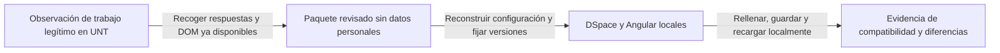

# Laboratorio local DSpace y nueva observación de UNT

Fecha: 2026-11-12. Dueño: **Int1 / retblast**, como parte de B3 y B8.
Estado: **plan; laboratorio no instalado, construido ni iniciado**.
Int2 aporta sus pruebas F5. Int3 no es responsable de infraestructura ni userscript.
No se modifica la app en esta entrega. La documentación oficial admite ejecutar
backend y frontend locales; los archivos Compose son para desarrollo/pruebas.

## 1. Decisiones confirmadas

- Nombres de autores en **mayúsculas y minúsculas**, como la tesis buena
  aprobada por el jefe. Mantener el desvío documentado respecto del manual.
  No abrir de nuevo esa decisión ni convertir a mayúsculas como arreglo.
- Derechos: emular **Acceso abierto**, como hace el jefe.
- **No crear, rellenar ni guardar envíos de prueba en UNT.** Tampoco borradores
  descartables. Escribir y perder foco puede activar guardado automático.
- Observar el sistema existente y ejecutar las pruebas de escritura en el lab.
  Un diagnóstico de solo lectura no demuestra aceptación ni persistencia.

El diagrama muestra cómo pasar de observación institucional a pruebas de escritura locales.

## 2. Qué ya tenemos y qué falta

| Evidencia local | Lo que aporta | Lo que no demuestra |
|---|---|---|
| `docs/DSPACE_API.md`: backend observado 8.1 | Punto de partida de versión | Versión vigente ni commit del frontend |
| HTML observado: Angular 17.3.12 | Versión del framework de esa captura | Tag exacto de dspace-angular ni modificaciones de UNT |
| `recursos/har-analisis/form_traditionalperuone.json`: 38 filas | Campos, tipos, obligatorios y vocabularios del formulario capturado | Que siga igual hoy ni todos los detalles del componente Angular |
| `vocab_*.json` | Etiquetas, URIs y filtros observados | Todas las páginas de cada catálogo ni sus cambios posteriores |
| `workspaceitem_get.json` | Valores predeterminados y estructura de secciones | Plantilla limpia: contiene un trámite concreto y exige despersonalización |
| Configuración de upload y licencia | Más secciones del envío | Toda la configuración del servidor |
| HTML y mock actuales | Selectores y casos DOM | Motor real de formularios Angular ni persistencia real |

No empezar de cero ni pedir otro HAR por rutina. Primero comparar una nueva
captura con estos artefactos. Si no existe una respuesta o un recurso en la
nueva captura, marcarlo ausente; no inventarlo ni reenviar solicitudes para obtenerlo.

## 3. Nueva observación en la máquina del jefe: prioridad de captura

**Objetivo:** reunir evidencia para reproducir su interfaz sin provocar escrituras
experimentales. Observar un formulario que el jefe ya tenga abierto para trabajo
legítimo. No pulsar «Nuevo envío» para preparar la observación: crea un workspace.
No recargar un borrador solo para capturar tráfico. Desactivar el userscript
antes de una futura sesión observada para impedir rellenos automáticos.

| Prioridad | Qué recoger | Cómo obtenerlo sin cambiar el formulario | Uso en el lab |
|---|---|---|---|
| A | Versiones de navegador, Tampermonkey, userscript, backend y frontend; fecha y colección | Anotar versiones visibles y respuestas ya recibidas. Guardar nombre/hash de bundles y `ng-version` del DOM | Fijar versiones; distinguir programas y colecciones |
| A | HAR de una apertura normal y legítima del formulario | DevTools → Network antes de esa apertura. Exportar registro al terminar la observación; no ejecutar acciones extra | Secuencia de carga, dependencias, errores y tiempos |
| A | JSON de configuración del formulario y orden de secciones | Network → Response de solicitudes ya hechas: `submissionforms`, `submissionsections`, configuración de envío; seguir URL realmente observada | Reconstruir `traditionalPeruOne`, upload y licencia |
| A | Vocabularios y opciones QUALDROP | Guardar respuestas ya presentes y metadatos de paginación/filtro. No seleccionar ni buscar opciones solo por la captura | Reproducir etiqueta, URI, tipo y orden de opciones |
| A | DOM renderizado de la zona del formulario | Elements → copiar `outerHTML` del contenedor ya renderizado; revisar y quitar datos personales localmente | Nombres, IDs, roles, contenedores, repetibles y estructura real |
| A | Capturas de pantalla de cada zona ya visible | Capturar sin editar; ocultar datos personales antes de compartir | Etiquetas, orden, validaciones visibles y controles personalizados |
| B | Bundles JS/CSS y traducciones usados por esa página | Guardar respuestas ya cargadas o sus URLs y hashes; anotar tema personalizado. Si faltan, pedir archivos al administrador | Identificar renderer/tema; no confundir HTML estático con Angular ejecutable |
| B | Predeterminados de colección y errores de validación iniciales | Respuestas existentes de workspaceitem y plantilla; sustituir personas por datos ficticios conservando tipos y cardinalidad | Fixture de inicio y campos ya ocupados |
| B | DOM de filas múltiples, listbox abierto y estados de error | Solo si aparecen durante una operación normal del jefe, sin pedir acciones de prueba | Estados que no están en una captura inicial |
| B | Momento de autosave, eventos y payloads | Solo observar si el jefe ya está realizando un envío real. No solicitar guardado, edición ni depósito para probar | Contrastar comportamiento normal; luego reproducirlo con datos ficticios |
| C | Código/configuración del despliegue de UNT | Pedir al administrador exportación acotada sin secretos, si está disponible | Reducir incertidumbre que el HAR no puede resolver |

Un HAR sin interacciones no contiene respuestas de búsquedas ni filas que nunca
se crearon. Una captura de pantalla no contiene el modelo Angular. El `outerHTML`
puede omitir el valor actual de propiedades DOM y estado en memoria. Son fuentes
complementarias; no usar una como prueba de las otras.

### Procedimiento de observación

1. Acordar observar trabajo real que ya vaya a realizarse. Si no hay formulario
   abierto ni tarea legítima prevista, posponer la captura; no crear uno.
2. Abrir Network y usar Preserve log durante esa operación. No iniciar sesión
   mientras se graba si ya existe sesión. No activar exportación con datos sensibles.
   No usar Replay, Edit and resend ni Copy as fetch para obtener cuerpos faltantes.
3. Dejar que el jefe trabaje normalmente. No tomar control del navegador mientras
   edita un campo; incluso cambiar el foco puede activar lógica de la aplicación. No pedir pulsar añadir/eliminar fila,
   escribir, seleccionar opción, cambiar colección, subir archivo ni guardar para
   experimentar. Si solo permite observación estática, recoger solo ese estado.
4. Guardar HAR, JSON, DOM y capturas de las respuestas/estados disponibles.
   Anotar qué acciones legítimas ocurrieron y cuáles no se observaron.
5. Si Network no conserva cuerpos o aparecen vacíos por caché, registrar el hueco.
   No forzar recarga ni cambiar ajustes de caché del navegador del jefe para resolverlo.
6. Revisar y despersonalizar offline antes de compartir. El paquete para el
   proyecto contiene datos ficticios, no una copia del trámite del estudiante.

### Protección del paquete capturado

Elegir HAR **sanitized**. Chrome excluye ciertos encabezados sensibles por
omisión, pero eso no acredita que todos los cuerpos o respuestas estén limpios.
La captura anterior del proyecto incluía credenciales en el cuerpo de login.
Eliminar entradas de autenticación, cookies, Authorization, CSRF/XSRF, tokens,
URLs con parámetros de sesión, cuerpos de login y datos personales en solicitudes,
respuestas, DOM y capturas. No recopilar el perfil del navegador ni exportar su
localStorage, sessionStorage, contraseñas o cookies. No copiar el HTML completo
de todas las pestañas. No subir HAR originales a git, issues ni servicios públicos.

Conservar solo URLs/configuración pública necesarias y sustituir identificadores
de trámites/personas por equivalentes ficticios consistentes. Preservar nombres
de campos, tipos, orden, cantidad de filas y referencias entre objetos. Registrar
SHA-256 y procedencia del paquete ya revisado. Guardar material local en una
carpeta ignorada de `recursos/`; publicar solo resumen y fixtures despersonalizados.

## 4. Qué pedir al administrador para una réplica más fiel

No se necesita una copia de la base de datos ni credenciales de UNT. Solicitar,
si puede proporcionarlo: versión/commit de DSpace y dspace-angular; tema y parches
propios; `submission-forms.xml`; `item-submission.xml`; vocabularios usados;
registros de metadatos RENATI/otros campos; valores de plantilla de la colección;
y configuración no secreta que afecte validación, formularios y autoguardado.
Comprobar los nombres reales de archivos según la instalación. Un HAR muestra
las respuestas observadas, no recupera todas estas fuentes automáticamente.

Sin esos archivos, se puede reconstruir el comportamiento observado a partir de
JSON y DOM. Etiquetar el resultado **réplica aproximada**, con cada diferencia
conocida. El número Angular 17.3.12 por sí solo no identifica el build de UNT.

## 5. Preparar el laboratorio — instrucciones para trabajo posterior de Int1

| Paso | Entrega concreta | Comprobación antes de continuar |
|---|---|---|
| L1 | Fuentes oficiales de backend 8.1 y frontend compatible, versiones fijadas | Registrar tags, commits y hashes. No usar imágenes flotantes `latest` o `dspace-8_x` como prueba de versión exacta |
| L2 | Compose de desarrollo con Angular, backend, PostgreSQL y Solr locales | URLs de UI/API locales; puertos ligados a loopback; volúmenes propios y nombres sin conflicto. Nunca apuntar UI local al backend UNT |
| L3 | Usuario, comunidad y colección ficticios | Credenciales exclusivas del lab; sin base de datos, archivo real ni cuenta institucional |
| L4 | Formulario y metadatos de colección reconstruidos | Comparar las 38 filas observadas: campos, tipos, orden, repetibles, obligatorios, QUALDROP, vocabularios, predeterminados y validaciones |
| L5 | Artefacto de userscript exclusivo de laboratorio | `@match` local; versión identificable y actualizaciones automáticas desactivadas. El artefacto de producción mantiene su destino institucional |
| L6 | Aislamiento verificable | En pruebas del navegador, bloquear y hacer fallar solicitudes fuera de los destinos locales permitidos. Revisar también URLs del backend y servidor Angular; no confiar solo en una prueba del navegador |
| L7 | Navegador real con Tampermonkey y datos ficticios | Registrar versión, permisos de conexión al buzón y resultado de B3/B4/B8; no sustituirlo por jsdom |
| L8 | Guía reproducible y prueba automatizada del área | Documentar comandos exactos que realmente funcionaron, arranque/parada sin borrar datos ajenos y verificación en CI. No declarar ejecutado este plan por escribir comandos |

Docker y su daemon responden en la máquina actual. Esa comprobación no instala
ni inicia el laboratorio y no demuestra aún que las imágenes sean compatibles.
No modificar servicios, NixOS ni instalar paquetes persistentes como parte de
este documento. La excepción al alcance MVP sobre contenedores se limita al
laboratorio de pruebas; no cambia el despliegue de VistoBueno.

## 6. Ensayos de aceptación exclusivamente locales

1. Comprobar diagnóstico sin escritura. Comparar campos, filas y solicitudes
   antes/después; no debe originar PATCH/POST/PUT/DELETE de metadatos.
2. Rellenar título, autores/DNI, asesor/DNI/ORCID, resumen, palabras clave, año y
   abierto con el userscript real. Comparar valores completos y URI de derechos.
3. Esperar guardado confirmado en el DSpace local. Recargar/reabrir el borrador
   **local** y comprobar persistencia. Una etiqueta visible no basta.
4. Repetir 1→2 y 2→1 autores y DNI, palabras clave, carga lenta, cambio de
   sección y edición manual. No deben quedar filas viejas ni datos desplazados.
5. Probar perfil de prueba con autofill, restauración de pestaña y Atrás/Adelante.
   Distinguir almacenamiento VistoBueno, estado Angular y datos del borrador.
6. Repetir los errores observados: campo ausente, deshabilitado, readonly,
   valor revertido y vocabulario no seleccionado. Nunca informar éxito falso.
7. Registrar commits/configuración, versiones, diferencias con UNT y resultado
   por campo. Mantener B3 abierto hasta contar con esta evidencia local.

## 7. Qué se puede afirmar después

El DOM y HAR de UNT más el lab permiten comprobar compatibilidad con la
configuración observada y el comportamiento del build local. No demuestran
identidad exacta con personalizaciones desconocidas. Un preflight de solo lectura
en UNT puede comprobar selectores y estados editables, sin rellenar ni guardar;
no certifica persistencia. No se impone un guardado experimental en producción
como requisito. Si queda una diferencia crítica, declararla y mantener manual
ese campo hasta resolverla; no vender certeza basada solo en el mock.

## Fuentes técnicas

- [DSpace Angular 8.1: entorno local con frontend y backend](https://github.com/DSpace/dspace-angular/blob/dspace-8.1/docker/README.md).
- [DSpace backend 8.1: Compose y configuración local](https://github.com/DSpace/DSpace/blob/dspace-8.1/dspace/src/main/docker-compose/README.md).
- [Definición oficial de formularios en 8.1](https://github.com/DSpace/DSpace/blob/dspace-8.1/dspace/config/submission-forms.xml).
- [Chrome DevTools: captura y exportación HAR](https://developer.chrome.com/docs/devtools/network/reference).
